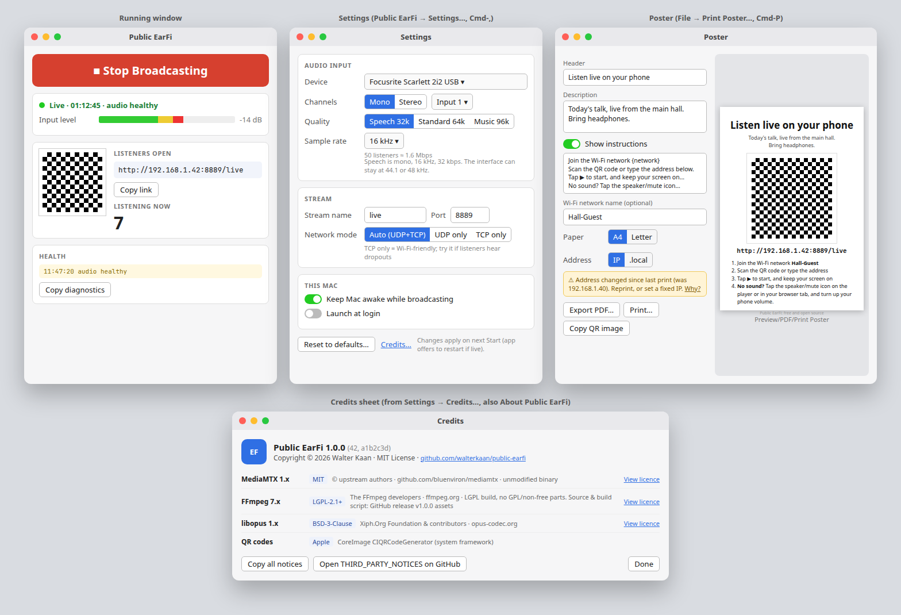

# Public EarFi

Stream live audio from a Mac to phone browsers on the same Wi-Fi. People scan a QR code and listen. They do not install an app or sign in.

Public EarFi is free and open source (MIT). Copyright (c) 2026 Walter Kaan. It is local only: the audio does not go to the internet.



## How it works

```
Sound desk → USB interface → ffmpeg (avfoundation, Opus)
          → RTSP → MediaMTX → WebRTC → phone browsers
```

Listeners open `http://<mac-ip>:8889/live`. The default is the Speech preset: Opus at 16 kHz, 32 kbps, mono, so 50 listeners are about 1.6 Mbps of audio. That is much lighter on a crowded venue access point than uncompressed audio. The interface can stay at its native 44.1 or 48 kHz; ffmpeg resamples.

The app bundles MediaMTX and an LGPL build of FFmpeg with libopus. You do not need Homebrew or Terminal to run it.

## What it is not

- It does not stream to the internet, and it does not record.
- Listeners must be on the same network. Guest Wi-Fi with client isolation, and separate VLANs, block them.
- There is no password. Anyone on the network who has the link can listen.
- Other apps can use the same audio interface at the same time. To record, use QuickTime, Audacity, or Audio Hijack. For Zoom, set the microphone to the USB interface, turn off automatic volume, and set noise suppression to Low (or use Original sound for musicians).

## Requirements

- macOS 13 Ventura or later
- Apple silicon or Intel
- A USB or Thunderbolt audio interface (the built-in microphone also works)
- Listeners on the same network, using a current browser

## Quick start

1. Download `Public-EarFi-x.y.z.dmg` from [GitHub Releases](https://github.com/walterkaan/public-earfi/releases).
2. Open the disk image and **drag Public EarFi to Applications**. Do not run it from the disk image or from Downloads. macOS quarantines apps that are opened from those places, and they then behave oddly.
3. Follow the first-open steps below.
4. Allow the microphone when asked. That permission is how the app hears the sound desk.
5. In Settings, confirm the input device (the app prefers a USB interface over the built-in mic).
6. Press **Start Broadcasting**.
7. Listeners scan the QR code or open the link. Tell them to keep the screen on: locking the phone may pause the audio.

### First open (Gatekeeper)

The app is ad-hoc signed, or signed with a self-made certificate. It is not notarized, so each Mac needs a one-time approval. There is no paid Apple Developer account.

1. Download the DMG, open it, and drag Public EarFi to Applications.
2. Double-click Public EarFi in Applications.
   - **macOS 15 Sequoia and later:** a dialog says *"Public EarFi" Not Opened – Apple could not verify…*. Click **Done** (not *Move to Trash*). Then open **System Settings → Privacy & Security**, scroll to **Security**, find *"Public EarFi was blocked…"*, and click **Open Anyway**. Authenticate, then click **Open**. Right-click → Open **no longer bypasses this on macOS 15 or later**.
   - **macOS 13–14:** Control-click (right-click) the app → **Open** → **Open**. The same **Open Anyway** button in System Settings → Privacy & Security also works.
3. Allow the microphone. If the firewall is on, allow incoming connections for mediamtx. mediamtx is the program phones connect to.
4. **After every update**, repeat these steps. The new download is quarantined again. With ad-hoc signing, macOS may also ask for the microphone again, because each build has a new identity. A self-signed release certificate is meant to keep that grant; confirm that on a test Mac before relying on it. If you previously clicked Don't Allow, go to System Settings → Privacy & Security → Microphone, or run `tccutil reset Microphone io.github.walterkaan.public-earfi`.
5. Advanced alternative: `xattr -dr com.apple.quarantine "/Applications/Public EarFi.app"`
6. If macOS says the app **"is damaged"**, the download or the signature is broken. Download it again, and report it as a bug if it still fails.

The same steps are in `docs/FIRST-OPEN.txt`, which is copied onto the DMG.

## Network and venue tips

- Plug the Mac into Ethernet if you can. The phones are on Wi-Fi; the Mac does not have to be.
- Give the Mac a **DHCP reservation** on the venue router, or set a manual IP in System Settings → Network. A printed poster stores the address it was made with. If the address changes, the app warns you to reprint it.
- The `.local` hostname survives IP changes. iPhones, iPads, and Macs resolve it. Many Android phones and many guest networks do not, so the IP address stays the default.
- Guest Wi-Fi often isolates clients from each other. Check that before the event.
- If listeners cannot connect, check System Settings → Network → Firewall. RTSP and the control API stay on 127.0.0.1 and do not need a firewall exception.
- **TCP only** in Settings is the Wi-Fi-friendly mode. Try it if listeners hear dropouts.
- Ask listeners to keep the phone screen on and the browser in front. Plug phones in for a long session.
- A busy access point has limited airtime. The default Speech preset is 32 kbps, about 1.6 Mbps for 50 listeners (a bit more with network overhead). Standard 64 kbps is about 3.2 Mbps for 50 people. 100 listeners at Speech is about 3.2 Mbps.

## Using the app

The main window is the broadcast. Settings, the poster, and the log each open in their own window.

**Running.** Start and Stop, a level meter (it works before you go live), the listener URL, a QR code, how many people are listening, and the latest health line. Copy diagnostics is on that window. Click the QR code to show it full screen. **View → Show Log** (Cmd-L) opens the full log.

**Settings.** **Public EarFi → Settings…** (Cmd-,). Input device, mono or stereo and which channel, Speech 32k / Standard 64k / Music 96k (Music is 96 kbps mono or 128 kbps stereo), and an Opus sample rate (8, 12, 16, 24, or 48 kHz). Speech is the default: mono, 16 kHz, 32 kbps. Choosing Speech sets those three. The interface is left at its native rate; ffmpeg's aresample converts. Stream name, port, and network mode are here too. Keep the Mac awake while broadcasting. Launch at login and start-on-open are off by default. Reset to defaults restores every setting, including the poster text, and does not delete logs. If you change a broadcast setting while live, the app offers to apply it with a brief interruption.

**Poster.** **File → Print Poster…** (Cmd-P) opens the poster window. **File → Export Poster PDF…** (Cmd-Shift-E) saves a PDF without opening that window. The poster window still has Export PDF, Print, and Copy QR image. **Edit** has Copy Listener Link and Copy QR Image. Header, description, instructions, optional Wi-Fi name, A4 or Letter, and IP or `.local`. The default paper size is Letter in the US and Canada and A4 elsewhere. The default instructions include: *No sound? Tap the speaker/mute icon on the player or in your browser tab, and turn up your phone volume.*

**Credits.** Settings → Credits…, and the About menu, list MediaMTX, FFmpeg, libopus, and the system QR code generator, with their licences.

Closing the laptop lid still sleeps the Mac unless it is on power with an external display. Display sleep itself is fine.

## Troubleshooting

| Symptom | What to try |
|---|---|
| No sound on a phone | Tap play. Tap the speaker/mute icon on the player or the browser tab. Turn the phone volume up. Keep the screen on. |
| The meter shows no signal | Confirm the desk is feeding the interface, and that Mono/Input matches the channel the desk uses. |
| Listeners cannot open the link | Same network, no client isolation, firewall allows mediamtx, and the poster matches the current address. |
| Dropouts or garbled audio | Use Speech (16 kHz). Wired Mac, and TCP only mode. The app leaves the interface at its native rate and resamples in ffmpeg. Forcing a 44.1 kHz USB device to 48 kHz, then compensating with `aresample=async=1`, was the combination that garbled audio in testing. |
| Microphone prompt on every update | Expected for ad-hoc builds. See the first-open section. |
| "Public EarFi is damaged" | Re-download. Do not run a half-copied app. |
| The app was quit hard and the port is busy | Open it again. It stops stale mediamtx and ffmpeg processes it started. |

Copy diagnostics puts the version, settings, and the last 200 log lines on the clipboard. Logs are also in `~/Library/Logs/Public EarFi/`.

## Build from source

```bash
brew install pkg-config   # if you do not already have it
./scripts/build-helpers.sh
./scripts/build-app.sh
open "dist/Public EarFi.app"
```

The helper script checks SHA-256 sums, builds libopus and FFmpeg with `--disable-gpl --disable-nonfree --enable-libopus`, and lipos arm64 with x86_64. Apple silicon is the priority. CI runs `swift test` and uploads an ad-hoc signed universal `.dmg`.

Release tags (`v*`) sign with the `RELEASE_SIGNING_P12` and `RELEASE_SIGNING_PASSWORD` secrets when those secrets exist, and fall back to ad-hoc signing when they do not. Notarization stays off until a Developer ID account exists.

## Licence

App code: [MIT](LICENSE), Copyright (c) 2026 Walter Kaan.

MediaMTX is MIT. FFmpeg is LGPL-2.1-or-later and is a separate executable, built without GPL or non-free components. libopus is BSD-3-Clause and is statically linked into that FFmpeg binary. Full texts and the required FFmpeg notice are in [THIRD_PARTY_NOTICES.md](THIRD_PARTY_NOTICES.md) and in the Credits sheet.

Each GitHub release attaches the matching FFmpeg source tarball and `scripts/build-helpers.sh`.

## Known limits

- Phone operating systems may pause or stop WebRTC audio when the screen locks or the browser is in the background.
- Every listener is their own stream. Plan on about 1.6 Mbps for 50 people at the default Speech preset, plus some protocol overhead. Standard 64 kbps is about 3.2 Mbps.
- A 50-listener, 2-hour session on a wired Mac is the acceptance target. It still has to be tried at a real venue.
